# KatiePoint sleep themes

Sleep screens for KatiePoint on the Xteink X4, X4 Pro, X4C and X3. Each one is an HTML/CSS
page: the static parts are baked into a black-and-white picture, and the live parts (your
reading stats, the book you're on, the time, your covers) are filled in by the reader every
time it goes to sleep.

**[Open the Sleep Theme Bench](https://insiderphd.github.io/katiepoint-sleep-themes/bench/)**
to try any theme with sample values, change it, or make your own.

## Install a theme

- **On the reader:** Settings → sleep theme picker → get more themes. Pick one and it
  downloads over WiFi.
- **From a computer:** connect the reader to WiFi, open its web page, go to
  **Sleep Themes**, and press Install on a theme in the store.

Both download the build for your reader's screen from `dist/` here.

## The themes

<!-- gallery:start -->

Rendered at 480×800 (X4, X4 Pro and X4C, which share a screen) with sample values; tap an
image for full size, or **X3** for the 528×792 build. Overlay themes are shown on a stand-in
book page: on the reader they sit on whatever page you were reading.

### Portrait

<table>
<tr>
<td align="center" valign="top" width="25%">
<a href="dist/800x480/cover-crop/preview.png">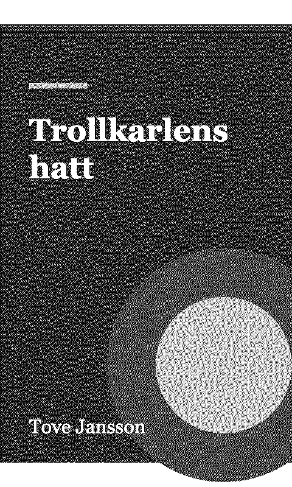</a><br>
<b>Book cover, full screen</b><br><code>cover-crop</code> · <a href="dist/792x528/cover-crop/preview.png">X3</a><br>
<sub>The cover of the book you're reading, cropped at the edges to fill the whole screen.</sub>
</td>
<td align="center" valign="top" width="25%">
<a href="dist/800x480/custom/preview.png">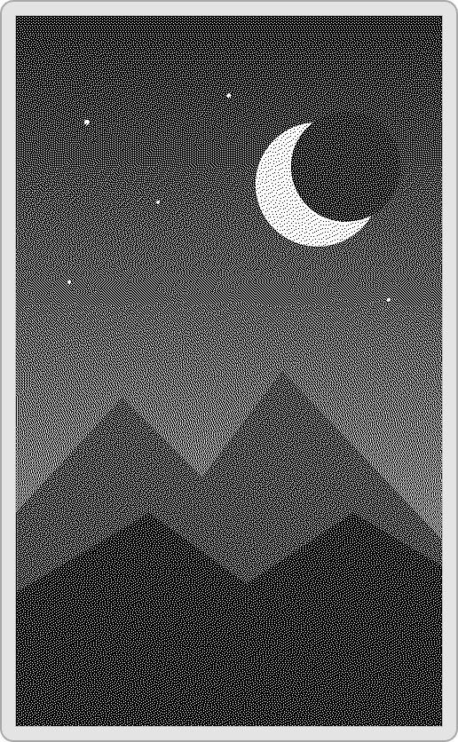</a><br>
<b>Your pictures</b><br><code>custom</code> · <a href="dist/792x528/custom/preview.png">X3</a><br>
<sub>A different picture each time from the /sleep folder on your SD card (or /sleep.bmp). Put BMP images there.</sub>
</td>
<td align="center" valign="top" width="25%">
<a href="dist/800x480/cover-or-custom/preview.png">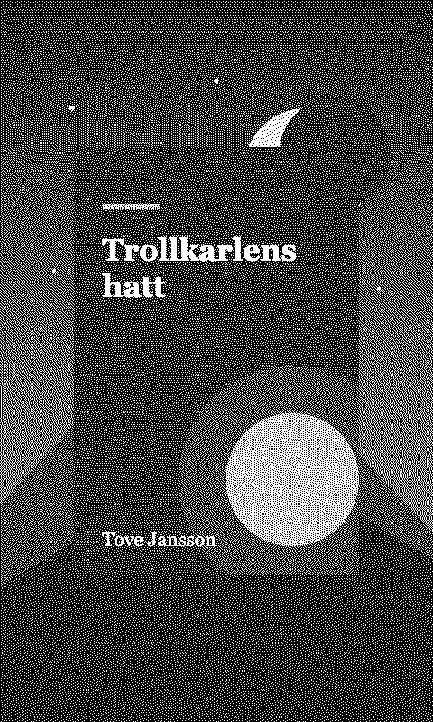</a><br>
<b>Cover on your pictures</b><br><code>cover-or-custom</code> · <a href="dist/792x528/cover-or-custom/preview.png">X3</a><br>
<sub>The cover of the book you're reading on top of a picture from your /sleep folder; just the picture when no book is open.</sub>
</td>
<td align="center" valign="top" width="25%">
<a href="dist/800x480/dark/preview.png">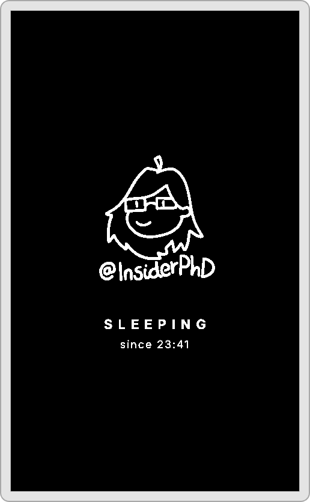</a><br>
<b>Sleeping, dark</b><br><code>dark</code> · <a href="dist/792x528/dark/preview.png">X3</a><br>
<sub>White on black: an open book and Sleeping, with the time you put it down.</sub>
</td>
</tr>
<tr>
<td align="center" valign="top" width="25%">
<a href="dist/800x480/light/preview.png">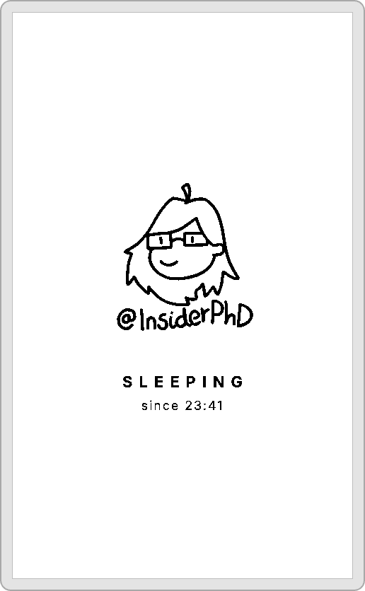</a><br>
<b>Sleeping, light</b><br><code>light</code> · <a href="dist/792x528/light/preview.png">X3</a><br>
<sub>Black on white: an open book and Sleeping, with the time you put it down.</sub>
</td>
<td align="center" valign="top" width="25%">
<a href="dist/800x480/blank/preview.png">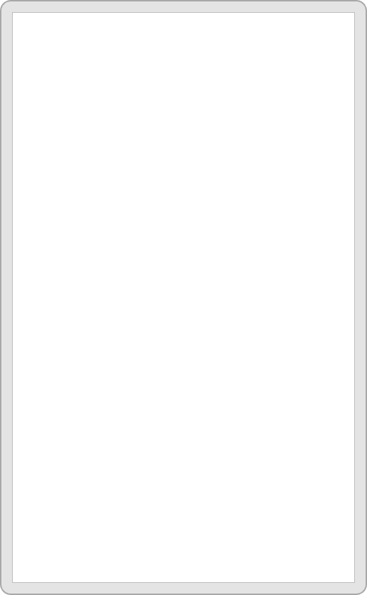</a><br>
<b>Blank</b><br><code>blank</code> · <a href="dist/792x528/blank/preview.png">X3</a><br>
<sub>A plain white screen.</sub>
</td>
<td align="center" valign="top" width="25%">
<a href="dist/800x480/page-overlay/preview.png"></a><br>
<b>Page with a moon</b> <sub>overlay</sub><br><code>page-overlay</code> · <a href="dist/792x528/page-overlay/preview.png">X3</a><br>
<sub>Leaves the page you were reading on screen, with a small moon and the time you put it down in the corner.</sub>
</td>
<td align="center" valign="top" width="25%">
<a href="dist/800x480/stats-overlay/preview.png">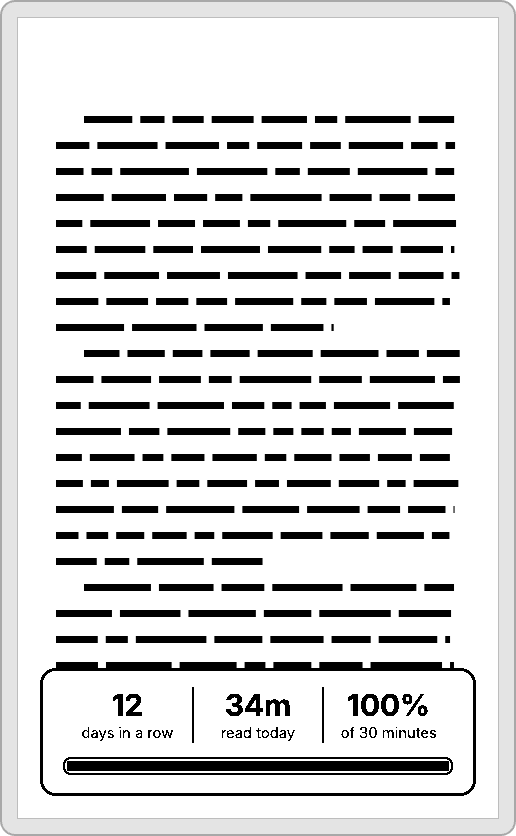</a><br>
<b>Page with your stats</b> <sub>overlay</sub><br><code>stats-overlay</code> · <a href="dist/792x528/stats-overlay/preview.png">X3</a><br>
<sub>Leaves the page on screen with a card of your streak, today's reading and your daily goal.</sub>
</td>
</tr>
<tr>
<td align="center" valign="top" width="25%">
<a href="dist/800x480/habit/preview.png">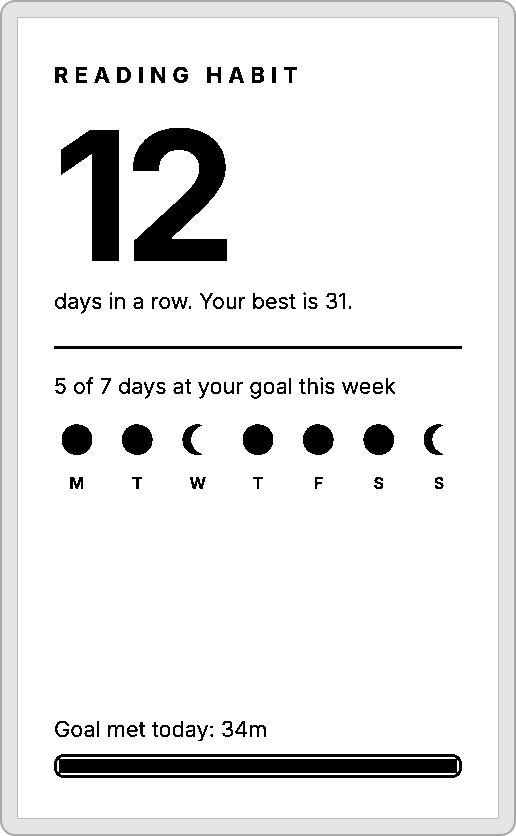</a><br>
<b>Reading habit</b><br><code>habit</code> · <a href="dist/792x528/habit/preview.png">X3</a><br>
<sub>Your streak in huge type, your best run, and this week's goal days as moons.</sub>
</td>
<td align="center" valign="top" width="25%">
<a href="dist/800x480/year-in-books/preview.png">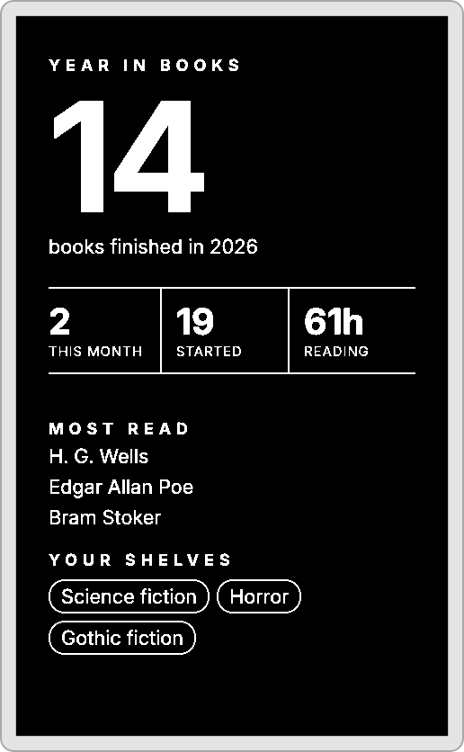</a><br>
<b>Year in books</b><br><code>year-in-books</code> · <a href="dist/792x528/year-in-books/preview.png">X3</a><br>
<sub>Books finished this year and this month, your most-read authors and the shelves you return to.</sub>
</td>
<td align="center" valign="top" width="25%">
<a href="dist/800x480/reader-profile/preview.png">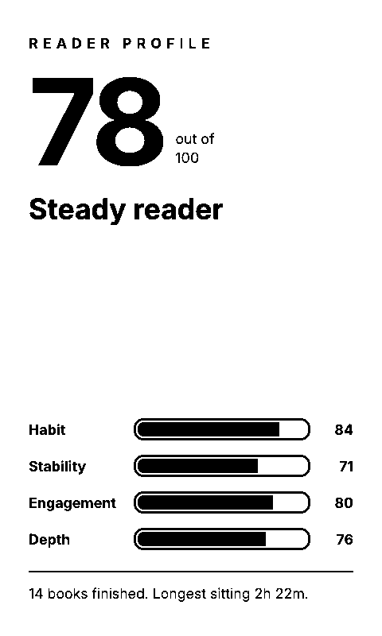</a><br>
<b>Reader profile</b><br><code>reader-profile</code> · <a href="dist/792x528/reader-profile/preview.png">X3</a><br>
<sub>Your reader score out of 100 with a one-word verdict, broken down into habit, stability, engagement and depth.</sub>
</td>
<td align="center" valign="top" width="25%">
<a href="dist/800x480/bedside-clock/preview.png">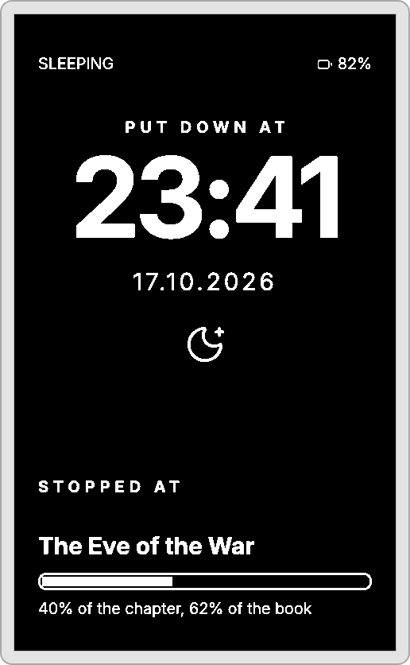</a><br>
<b>Lights out</b><br><code>bedside-clock</code> · <a href="dist/792x528/bedside-clock/preview.png">X3</a><br>
<sub>When you put the book down, big, with the date, battery and how far into the chapter you got.</sub>
</td>
</tr>
<tr>
<td align="center" valign="top" width="25%">
<a href="dist/800x480/library-card/preview.png">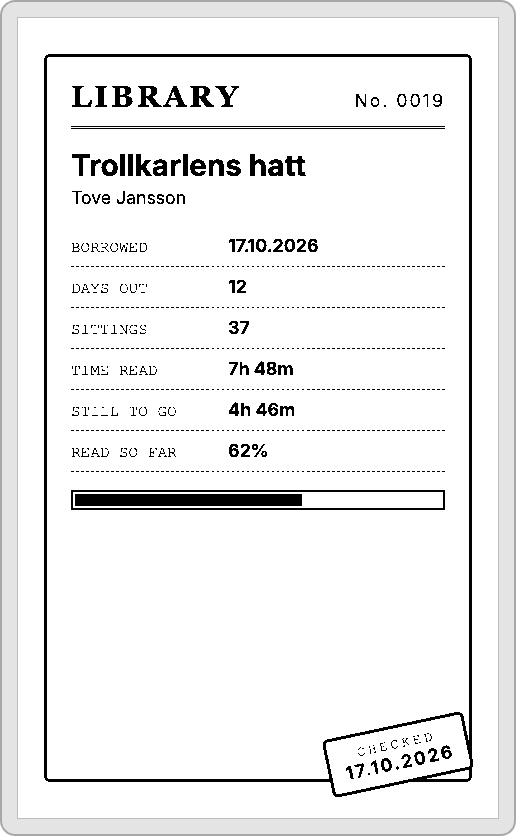</a><br>
<b>Library card</b><br><code>library-card</code> · <a href="dist/792x528/library-card/preview.png">X3</a><br>
<sub>The book you're reading as a library checkout card: when you borrowed it, days out, sittings, and a date stamp.</sub>
</td>
<td align="center" valign="top" width="25%">
<a href="dist/800x480/gazette/preview.png">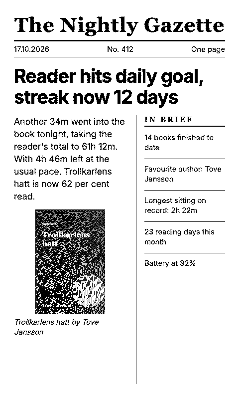</a><br>
<b>The Nightly Gazette</b><br><code>gazette</code> · <a href="dist/792x528/gazette/preview.png">X3</a><br>
<sub>Tonight's reading as a newspaper front page, with a headline written from your stats.</sub>
</td>
<td align="center" valign="top" width="25%">
<a href="dist/800x480/departures/preview.png">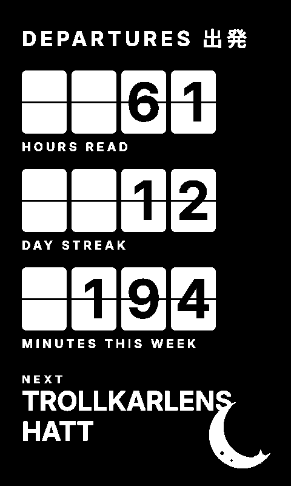</a><br>
<b>Departures</b><br><code>departures</code> · <a href="dist/792x528/departures/preview.png">X3</a><br>
<sub>A split-flap board of your hours read, streak and minutes this week, with the book that's next.</sub>
</td>
<td align="center" valign="top" width="25%">
<a href="dist/800x480/finished-ticket/preview.png">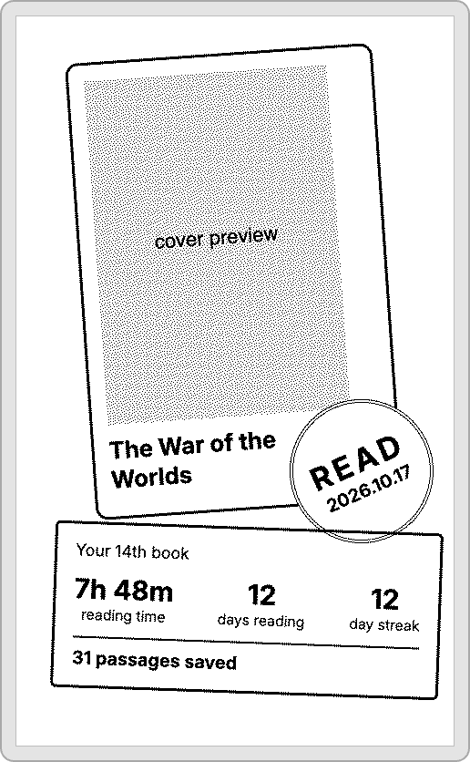</a><br>
<b>Finished-book ticket</b><br><code>finished-ticket</code> · <a href="dist/792x528/finished-ticket/preview.png">X3</a><br>
<sub>A tilted cover, a READ stamp with today's date, and a ticket with the time it took.</sub>
</td>
</tr>
</table>

### Landscape

<table>
<tr>
<td align="center" valign="top" width="50%">
<a href="dist/800x480/bookmark/preview.png">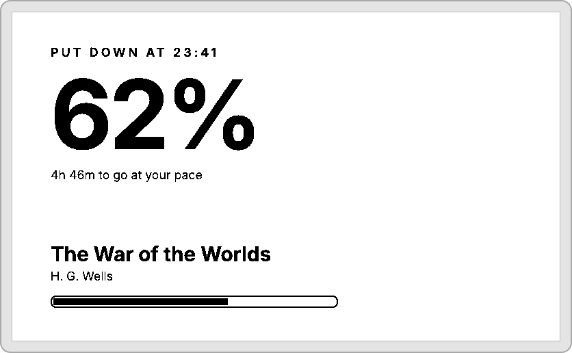</a><br>
<b>Bookmark</b><br><code>bookmark</code> · <a href="dist/792x528/bookmark/preview.png">X3</a><br>
<sub>Where you put the book down: progress in huge type, time left at your pace, title and cover.</sub>
</td>
<td align="center" valign="top" width="50%">
<a href="dist/800x480/shelf/preview.png">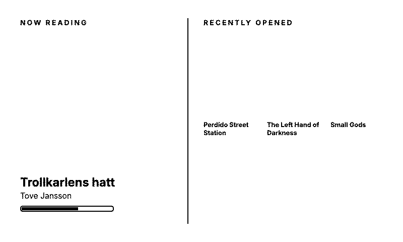</a><br>
<b>Shelf</b><br><code>shelf</code> · <a href="dist/792x528/shelf/preview.png">X3</a><br>
<sub>The book you're reading beside the last few you opened.</sub>
</td>
</tr>
<tr>
<td align="center" valign="top" width="50%">
<a href="dist/800x480/rhythm/preview.png">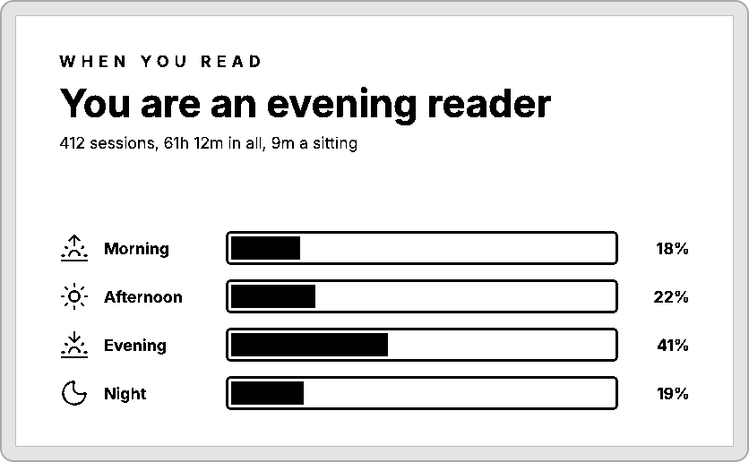</a><br>
<b>Reading rhythm</b><br><code>rhythm</code> · <a href="dist/792x528/rhythm/preview.png">X3</a><br>
<sub>When in the day you read, as four bars, and whether that makes you an early bird or a night owl.</sub>
</td>
<td align="center" valign="top" width="50%">
<a href="dist/800x480/spines/preview.png">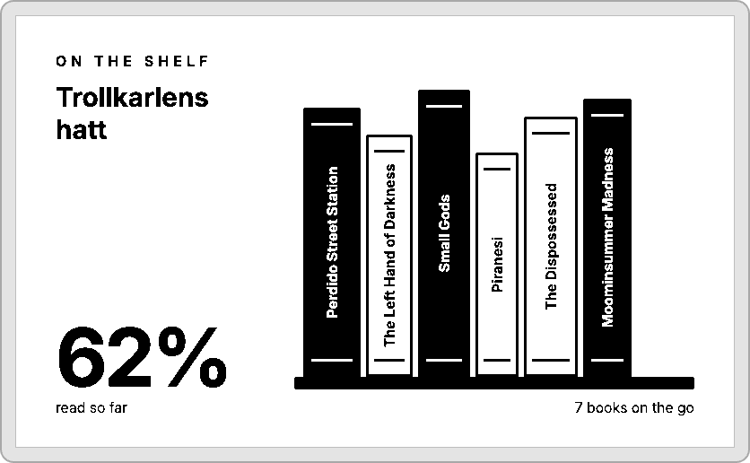</a><br>
<b>Spines</b><br><code>spines</code> · <a href="dist/792x528/spines/preview.png">X3</a><br>
<sub>Your recent books as spines on a shelf, titles running up them, beside the one you're reading.</sub>
</td>
</tr>
</table>

<!-- gallery:end -->

## Make a theme

1. Open the [bench](https://insiderphd.github.io/katiepoint-sleep-themes/bench/), pick a
   starting point, and drag values, text, covers and icons onto the screen. It checks the
   reader's limits as you go.
2. **Save .zip**, then on the reader's **Sleep Themes** web page choose the zip, Compile,
   and Install.

The format reference (every attribute, value, expression and limit) is
[docs/sleep-themes/README.md](https://github.com/InsiderPhD/crosspoint-reader/blob/master/docs/sleep-themes/README.md)
in the firmware repo. To add yours to the store, see [CONTRIBUTING.md](CONTRIBUTING.md).

## How this repo is built

```
themes/<id>/theme.html   the theme (plus theme.json: name, description, order; and any SVGs)
fonts/                   Inter, added to any theme that uses it
tools/compiler/          the firmware's compiler page, run headless
tools/compile.mjs        compiles every theme for every screen into dist/
tools/build-bench.mjs    writes every theme into the bench's Start from list
tools/check-themes.mjs   runs the bench's checks on every theme, at both sizes
tools/build-readme.mjs   writes the screenshot gallery above from the previews
bench/index.html         the Sleep Theme Bench (GitHub Pages)
dist/index.json          the store catalog the reader and its web page read
```

`npm run build` (or the GitHub Action, on every push to `themes/`, `tools/` or `fonts/`)
regenerates `bench/`, `dist/` and the gallery in this README. Locally, `CHROME_PATH` can point at an installed Chrome
instead of Puppeteer's download.

## Licences

Code: MIT ([LICENSE](LICENSE)). Inter: SIL Open Font License 1.1
([fonts/OFL-Inter.txt](fonts/OFL-Inter.txt)). Lucide icons in the bench: ISC.
